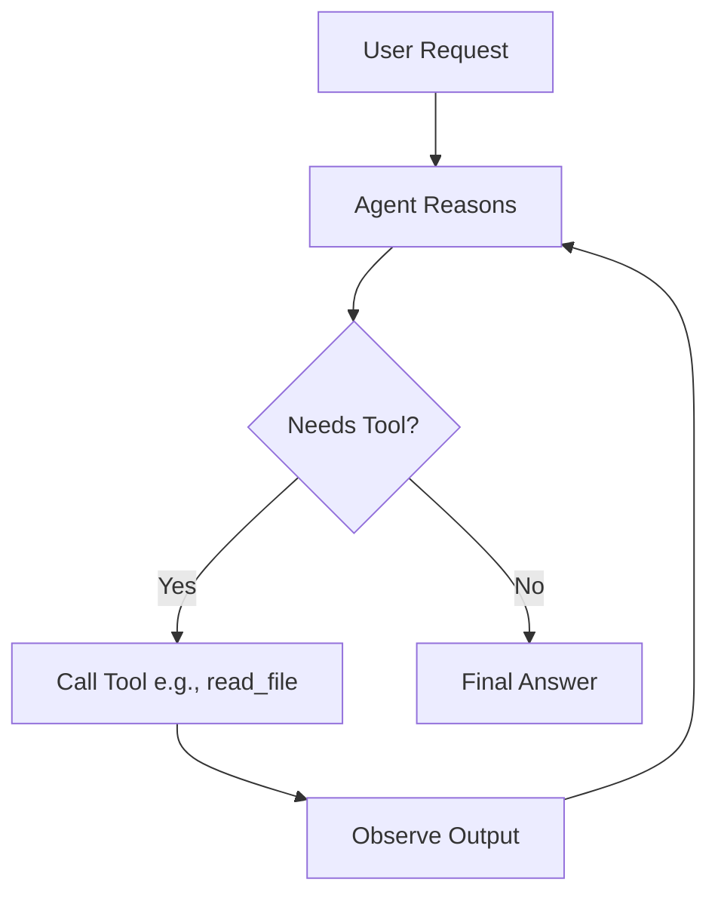

# Tool Integration

> An agent becomes useful when it can act, and tools are how it acts.

---

## What it is

Tool Integration (also known as Function Calling) is the mechanism that allows an LLM to interact with the outside world. Instead of just returning text, the model can return a structured request to execute a specific function, such as reading a file, querying a database, or triggering a CI pipeline.

This is powered by the ReAct (Reasoning and Acting) loop: the agent observes its environment, reasons about what to do next, executes a tool, observes the result, and loops until the goal is achieved.



---

## Why it matters in production

Without tools, an LLM is cut off from the world. It cannot check whether code compiles, read a Slack message or commit to a repository.

In production, agents have to act, and letting an LLM run arbitrary code is a serious security risk. A tool is a typed boundary where the application validates the model's request, limits its scope and runs it.

---

## How Agenthood implements it

Agenthood implements this via the `ISkillManifest` interface, managed by the `SkillDiscovery`, and executed within a `ReActLoop`.

This allows members of the Society to use tools directly. The interface is in `src/skills/discovery/ISkillManifest.ts` (shipped in v2.0.0):

```typescript
export interface ISkillManifest {
  name: string;
  description: string;
  schema: JSONSchema;
  execute(args: any): Promise<string>;
}

export class SkillDiscovery {
  discover(projectDir: string): ISkillManifest[];
  get(name: string): ISkillManifest | undefined;
  list(): ISkillManifest[];
}
```

Every action is defined by a strict `JSONSchema` contract.

---

## Hands-on example

When the runtime is active, you can provide tools directly to an agent:

```bash
# Invoke an agent and provide it with filesystem skills
npx agenthood run architect "Draft an ADR" --tools fs-write,fs-read
```

Or in TypeScript (future milestone):

```typescript
const registry = new SkillRegistry();
registry.register(new FileReadSkill());

const loop = new ReActLoop(provider, registry);
await loop.run("Read the package.json and summarize dependencies.");
```

---

## Further reading

- [`src/skills/discovery/ISkillManifest.ts`](../../../src/skills/discovery/ISkillManifest.ts): the skill contract (shipped in v2.0.0)
- [`src/skills/discovery/SkillDiscovery.ts`](../../../src/skills/discovery/SkillDiscovery.ts): dynamic skill discovery
- [ReAct: Synergizing Reasoning and Acting in Language Models](https://arxiv.org/abs/2210.03629): the foundational paper on tool use


