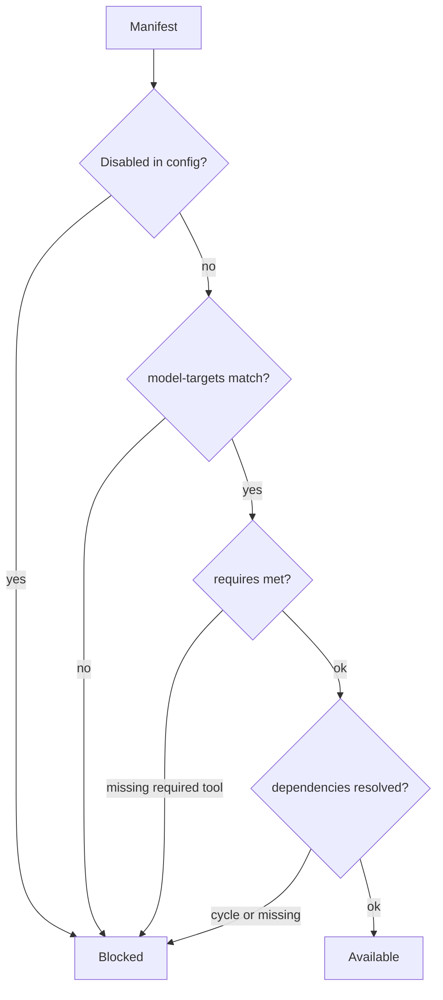
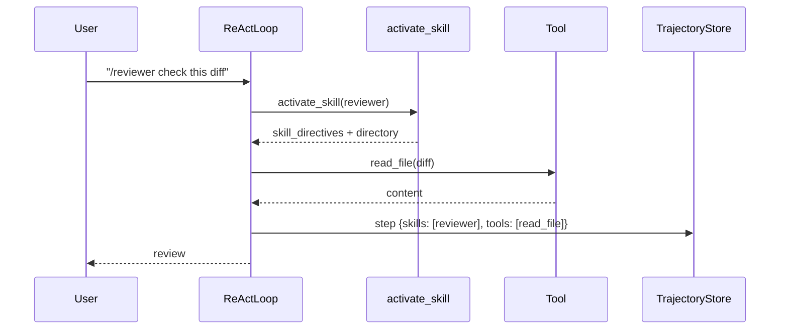

# The Skill System, Inside

> How a directory of markdown becomes a tool the model can call, and where to change that.

---

## The pipeline

Five stages, each with one job. A skill that is not discovered cannot be activated; a skill that is
not gated cannot be listed; a skill that is not activated contributes nothing to the prompt.

---

## 1. Discovery

`SkillDiscovery.discover(projectDir)` walks search roots in precedence order and keys skills by name:

| Order | Root | Scope |
|-------|------|-------|
| 1 | `~/.agents/skills` (XDG paths first on Linux/macOS) | user |
| 2 | `<project>/.agents/skills` | project |
| 3 | `<project>/.agenthood/skills` | project |
| 4 | `<project>/.claude/skills` | project |
| 5 | `<project>/skills` | project |

**Project beats user.** When the same name appears twice the later project root wins, with a warning;
within one scope the earlier root wins. A collision is reported, never silently dropped: two skills
with one name is a configuration bug the user has to see.

Two bounds keep a large repository from stalling startup: depth 6 inside a root, and 2000 directories
across the scan. Hitting the cap stops the scan and warns that results are partial. `.venv`,
`__pycache__`, `.tox`, `vendor` and `target` are skipped. `.gitignore` is deliberately **not** parsed:
a partial matcher would silently hide skills, which is worse than a slow scan.

Remote catalogs (`.well-known/agentskills`) are advisory: unreachable means stale cache, then local
skills. A catalog is never a hard dependency of a run (ADR-035).

## 2. Parsing

`SkillParser` reads the YAML frontmatter and the body, then validates the shape:

- `name`, `description`, `license` (name must match the directory; `verify` enforces it)
- `allowed-tools`: declared tool names, resolved through the member vocabulary
- `metadata.*`: `author` (registry namespace), `version`, `priority`, `conditions`, `variants`
- gating fields: `model-targets`, `requires`, `dependencies` (ADR-037)
- behaviour switches: `hidden`, `router`, `disable-model-invocation`, `compaction-replay`

The parse result is cached in `.agenthood/skill-cache/metadata.json`, keyed by path and validated by
`mtimeMs` + `size`. A hit skips the read, the YAML parse, the injection scan and the spec checks
(ADR-038). `agenthood cache clear` drops it; `agenthood skills --stats` shows hit counts.

Skill content is untrusted at parse time: boundary tags are stripped and the body is wrapped in
`<skill_directives>` before it enters a prompt.

## 3. Gating

`gateSkills(manifests, availability)` runs once at discovery and decides what the catalog may show
(ADR-037):

Blocked skills are hidden from the catalog and refused by `activate_skill`: a skill that cannot run
here must not be offered. `agenthood skills --show-disabled` names each one and the reason.

## 4. Activation

`activate_skill(name)` is a tool call, and the only way a body enters the prompt. It:

1. resolves fallbacks when the named skill is blocked (ADR-037)
2. selects the model variant (`metadata.variants`) when one matches the current model
3. applies the budget: compressing or truncating a body too large for the window
4. reports missing relative references as warnings, not failures
5. wraps the body in `<skill_directives>` with its directory, and records the activation

A second activation of the same skill returns a pointer instead of the body: the block is already in
the transcript, and compaction protects it. `force: true` reloads. A `compaction-replay: false` skill
opts out of both: compaction may summarise it, so re-activation always re-injects.

Activation is additive across skills: the effective tool scope is the **intersection** of every active
skill's `allowed-tools` (ADR-032), so activating one skill can temporarily narrow another's tools.

## 5. Execution

Two execution surfaces share the discovered manifest:

| Surface | What runs | Sandbox |
|---------|-----------|---------|
| Instructions | The model follows the body | none; it is prompt text |
| Bundled scripts | `run_skill_script` picks a runtime by extension, then shebang | Docker by default; host only for a trusted author (ADR-036) |

A script run is authorized by activation (the skill must be active), bounded by a per-script timeout,
capped at 30 KB of inline output with the rest spilled to a file, and audited. One-off commands are
version-pinned; anything else is refused. Output caching is opt-in (`skills.cacheOutputs`) and keyed by
skill, script, arguments and script digest.

## Lifecycle of one run

Every step records the skills active when it ran and every tool it called, which is what
`trace --skill`, `trace --tool` and `trace --activations` read. A checkpoint stores the active skill
names, so a resumed run restores the same scope instead of starting empty.

---

## Where to change what

| You want to | Touch |
|-------------|-------|
| Add or edit a skill | `skills/<name>/SKILL.md`: nothing else |
| Change search roots or precedence | `src/skills/discovery/SkillDiscovery.ts` |
| Change a frontmatter field | `SkillParser.ts`, `ISkillManifest.ts`, `CACHE_VERSION` |
| Change gating rules | `src/skills/activation/gate.ts` (ADR-037) |
| Change the activation block | `src/skills/activation/skillContent.ts` |
| Change tool enforcement | `src/skills/activation/scope.ts`, `ReActLoop` (ADR-032) |
| Change script execution | `src/skills/execution/` (ADR-036) |
| Change the catalog format | `src/skills/catalog/format.ts` |
| Change cache behaviour | `src/skills/discovery/manifestCache.ts` (ADR-038) |
| Add an observability signal | `src/skills/observability.ts`, then the command that prints it |

Extension points, in order of how often you will need them:

1. **A new skill**: one file. No registration, no rebuild.
2. **A new frontmatter field**: parser, manifest type, cache version, and a gate if it restricts.
3. **A new tool**: classify it in `MemberAgent` (read-only/write/trusted) or it is denied by default.
4. **A new search root**: one entry in `discover()`; precedence is the array order.
5. **A new runtime for scripts**: `language.ts` detection plus the sandbox allowlist (ADR-036).

## Invariants

- A skill name is its key: directory, frontmatter and lockfile entry agree.
- Nothing outside `<skill_directives>` is treated as instruction text.
- A blocked skill is never listed and never activated.
- A tool the member's profile does not classify is denied, not granted.
- Discovery is advisory-stale, never fatal: a cache miss costs time, not correctness.

## References

- [ADR-028](../adr/ADR-028-skill-frontmatter-contract.md) · [ADR-032](../adr/ADR-032-skill-tool-enforcement.md)
  · [ADR-036](../adr/ADR-036-skill-script-execution-and-sandboxing.md)
  · [ADR-037](../adr/ADR-037-skill-usability-gating-and-variants.md)
  · [ADR-038](../adr/ADR-038-skill-discovery-and-execution-caching.md)
  · [ADR-039](../adr/ADR-039-member-naming-and-identity.md)
  · [ADR-040](../adr/ADR-040-skill-body-structure.md)
- [Agent system](agent-system.md): members, profiles and delegation
- [Creating a Member](../guides/creating-a-member.md): the authoring path
