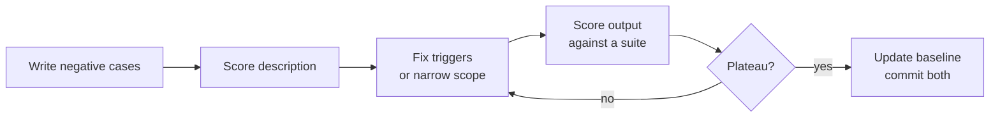

# Evaluating a Skill

> A skill you cannot measure is a prompt you hope is working. This page is how to find out, cheaply,
> before and after every change.

Three things get confused under "testing a skill". They fail differently and are measured differently:

| Question | Surface | Tool |
|----------|---------|------|
| Does the right skill get picked? | routing / description | `agenthood eval --triggers` |
| Does it do the job when picked? | output quality | `agenthood eval --suite` |
| Did it get worse than before? | regression | `--baseline`, `--convergence`, `--replay` |

A skill with a perfect body and a vague description never runs. A skill with a perfect description and
a vague body runs and produces nothing.

---

## 1. Trigger rate: does it get picked?

A trigger query set is two lists: prompts that must activate the skill, and prompts that must not.

```json
{
  "member": "scribe",
  "shouldTrigger": [
    "write a commit message for the current diff",
    "draft the changelog entry for this release"
  ],
  "shouldNotTrigger": [
    "debug the segmentation fault in the parser",
    "write unit tests for the router"
  ]
}
```

```bash
agenthood eval scribe --triggers evals/triggers/scribe.json
agenthood eval scribe --triggers evals/triggers/scribe.json --semantic   # needs a provider key
```

Two surfaces are scored. **Keyword** is the deterministic router — free, CI-safe, and the baseline.
**Semantic** embeds the description and picks the nearest, approximating how an external loader
chooses a skill. A high keyword score with a low semantic score means the description is being matched
by words a user would type, not by meaning.

The report gives precision, recall and F1, and names the queries that went the wrong way. Those
queries are the test cases: a false negative is a missing trigger word, a false positive is a
description that claims too much scope.

**Write the `shouldNotTrigger` list first.** Everyone writes positive cases; the negatives are what
stop a skill from swallowing its siblings' work.

## 2. Output quality: does it do the job?

An eval suite is a list of tasks with assertions. A task passes when its assertions pass.

```json
{
  "member": "scribe",
  "tasks": [
    {
      "id": "conventional-commit",
      "input": "Staged diff: adds a retry to the HTTP client.",
      "assertions": [
        { "type": "matches", "value": "^(feat|fix|refactor)\\(" },
        { "type": "notMatches", "value": "\\bwip\\b" }
      ]
    }
  ]
}
```

```bash
agenthood eval scribe --suite evals/developer-agent-suite.json
agenthood eval scribe --suite evals/developer-agent-suite.json --json
```

The assertions that earn their keep are the ones a plausible-but-wrong answer fails: the required
prefix, the forbidden word, the number that must be exact. "Contains the word 'commit'" passes for
both a good and a bad answer and measures nothing.

## 3. Grading, when output is prose

An assertion cannot check whether a review is *good*. Two options, in order:

1. **Make the output checkable.** A review that must list `file:line — severity — issue` can be
   asserted on. Prefer this: it improves the skill and makes the eval trivial.
2. **Use the LLM judge.** `agenthood eval` scores prose against a rubric with a second model. It is
   slower, costs tokens and varies run to run — use it for a threshold (`score >= 0.7`), not for
   exact comparison.

Grading is the part people skip. A suite with no failing case in its history is a suite that asserts
what the skill already does.

## 4. Regressions: did it get worse?

```bash
agenthood eval scribe --suite evals/developer-agent-suite.json --update-baseline
agenthood eval scribe --suite evals/developer-agent-suite.json              # compares to baseline
agenthood eval scribe --convergence                                        # trend over run history
agenthood eval scribe --replay --limit 20                                  # re-run stored traces, compare drift
```

`--update-baseline` is an explicit act: it says "this is the new normal". Run it only after reading
the diff between the report and the baseline, or the baseline becomes a ratchet that hides every
regression.

`--replay` is the cheap one: it re-runs stored trajectories, so it measures output drift for real
tasks instead of suite tasks, with no new authoring.

**Convergence** is the iteration signal. While a change improves F1 by more than the noise threshold,
keep iterating; when it plateaus, stop and ship. Optimising past the plateau overfits the query set.

## 5. Iteration loop



`agenthood optimize <member> --triggers <path>` runs the generate/score loop for you: it scores the
current description, generates variants, scores each on a held-out split, and keeps the best. `--apply`
writes the winner to the member spec. Use it when the description is the problem; use your own edit
when the *scope* is the problem — no description rewrite fixes a skill doing two jobs.

Every loop needs a held-out split. Scoring a description against the queries it was tuned on reports
success by construction.

## 6. In CI

| Check | Cost | When |
|-------|------|------|
| `verify --strict` (structure, lockfile) | free | every PR |
| `eval --triggers` (keyword surface) | free | every PR touching a description |
| `eval --suite` with assertions | provider key | every PR touching a body |
| `eval --suite` with LLM judge | provider key, slower | before release |
| `eval --replay` | provider key | nightly, or before release |

The free checks are the ones that must never be skipped — they catch the failure that makes every
other measurement meaningless: a skill nobody activates. The paid checks belong on the PR that changed
the skill, not on every PR.

Store the query sets in `evals/triggers/<member>.json` and suites in `evals/`, so the tests live with
the thing they test. A skill's PR that changes its description without changing its trigger set is a
PR that skipped its own test.

## Verification

- The trigger set has at least as many negative cases as positive
- Keyword surface F1 is above what the skill needs, and the failing queries are understood
- The suite contains at least one blocking assertion per task
- A baseline exists and was updated deliberately, with the diff read
- The paid eval runs on the PR that changed the skill

## References

- [Skill Best Practices](skill-best-practices.md) — what a good body looks like before measuring it
- `CONTRIBUTING.md` — the eval, trigger-rate and convergence commands in full
- `evals/triggers/scribe.json` — a complete query set
- [The Tester](../../skills/tester/SKILL.md) — how the Society writes the assertions
